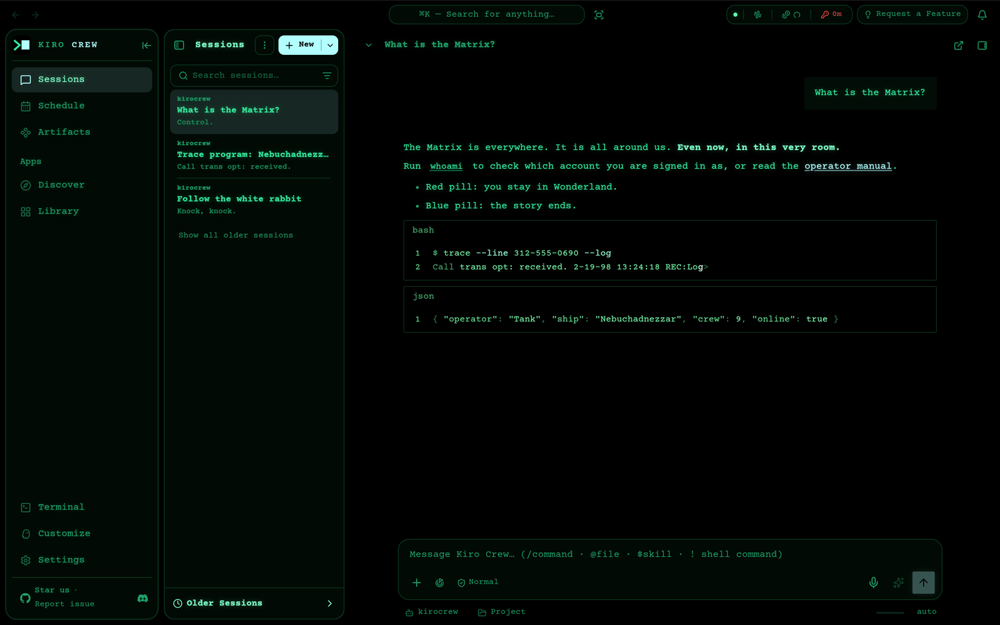
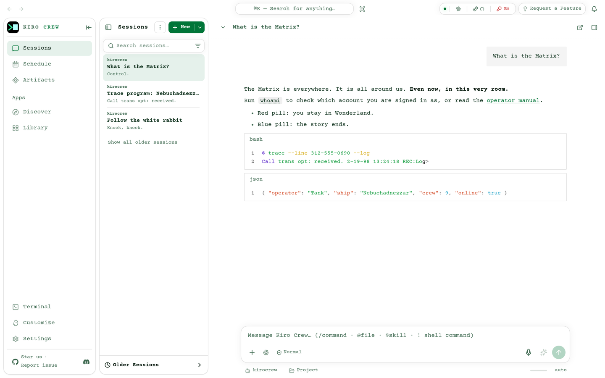

# Kiro Crew theme: Matrix (no screensaver)

An unofficial [Kiro Crew](https://github.com/kirodotdev/KiroCrew) theme pack modeled on the computer screens in *The Matrix* (1999).

This is the full [Matrix pack](https://github.com/leozhad/kirocrew-theme-matrix) without the idle screensaver. The colors, fonts and cursor are the same.

| Part | What it does |
|---|---|
| Dark mode | Neo's terminal: black CRT, green phosphor text with glow, Courier type, the film's block cursor color, code blocks in one green |
| Light mode | The Construct (the white loading program): neutral white with green ink |
| Thinking indicator | A blinking block cursor |

| Dark mode | Light mode |
|---|---|
|  |  |

## Install

1. Open Settings → Display → Theme.
2. Under **Install Theme**, choose **GitHub** and paste `https://github.com/leozhad/kirocrew-theme-matrix-quiet`.
3. Install, then pick **💊 Matrix (no screensaver)** in the Theme list.

Courier Prime feeds both the Sans and Mono font roles. To keep your OS font, pick System under Settings → Display → Font Family.

To update, install the same URL again.

How it was matched to the film, and what a pack cannot change, are in the [full pack's README](https://github.com/leozhad/kirocrew-theme-matrix#how-close-it-is-to-the-film).

## Credits and licenses

See [`LICENSE.txt`](LICENSE.txt). The pack is MIT. Courier Prime is under SIL OFL 1.1.

"The Matrix" is a trademark of Warner Bros. This fan theme has no affiliation with Warner Bros.
